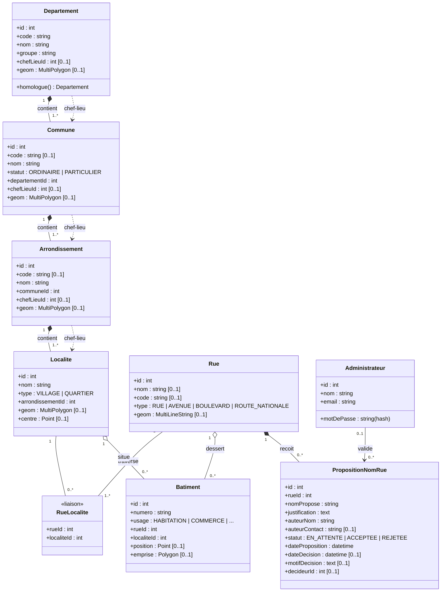

# Diagramme de classes — Découpage territorial du Bénin

Version 7 — validée le 2026-11-05.

## Règles de gestion

- **Hiérarchie** : Département (12) → Commune (77) → Arrondissement (546) → Localité (village / quartier) → Rue → Bâtiment.
- **Groupe** : `Departement.groupe` vaut l'une des 6 valeurs `ATACORA-DONGA`, `ATLANTIQUE-LITTORAL`, `BORGOU-ALIBORI`, `MONO-COUFFO`, `OUEME-PLATEAU`, `ZOU-COLLINES`. `homologue()` renvoie l'autre département du même groupe.
- **Chefs-lieux** (optionnels) : un département pointe vers une de ses communes, une commune vers un de ses arrondissements, un arrondissement vers une de ses localités. Le chef-lieu doit appartenir à l'élément parent.
- **Rues** : une rue n'appartient à aucune commune ; elle est liée aux localités qu'elle traverse (`RueLocalite`, plusieurs-à-plusieurs). Elle peut donc traverser plusieurs communes ou départements ; les communes traversées sont déduites. Pas de tronçons pour l'instant.
- **Bâtiment** : rattaché à une rue et à une localité précises.
- **Propositions de nom de rue** : ouvertes à tous sans compte (`auteurNom`, `auteurContact` optionnel), statut initial `EN_ATTENTE`, validation ou rejet (avec motif) par un `Administrateur`. Une proposition acceptée recopie son nom dans `Rue.nom`. Les votes sont prévus pour plus tard.
- **Cartographie** : PostGIS, SRID 4326 (WGS84), toutes les géométries sont optionnelles ; l'API les expose en GeoJSON.
